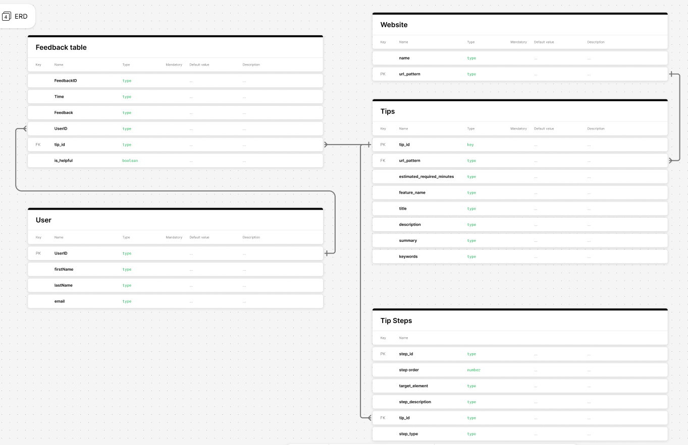

# PrepTip

A Chrome extension that gives teachers short, guided help inside the web tools they already use. IS 401 prototype, built from our [PRD](docs/PRD.md) and [clickable mockup](docs/mockup/preptip-mockup.html).

## App Summary

Teachers are expected to use general-purpose tools such as Google Sheets, Canva and Canvas, but those tools are built for everyone, not for classrooms. When a teacher hits a wall, like wanting failing grades to turn red automatically, they either spend scarce prep time learning a complex feature or fall back on slow manual workarounds. PrepTip is a Chrome extension that recognizes which tool a teacher is on and opens a side panel of short, teacher-specific tips for that tool. Choosing a tip starts a guided walkthrough that highlights the exact menu to click on the real page, notices when the teacher opens the wrong menu, and points them back. Teachers can search tips in their own words, request a tip that doesn't exist yet, and rate each tip so the most helpful ones stand out. PrepTip also protects the classroom by blocking redirects to flagged websites before they load, and adds a "Download for Slides" helper on YouTube. All tips live in a Supabase database, so the team can add new help without shipping a new version of the extension.

## ERD



| Table | What it stores |
|---|---|
| `websites` | Each supported tool, keyed by a URL pattern such as `docs.google.com/spreadsheets` |
| `tips` | A how-to for one website: title, summary, description, feature name, estimated minutes and search keywords |
| `tip_steps` | The ordered steps of a tip. `step_type` is `guided` (PrepTip highlights it) or `your_turn` (the teacher fills something in). `target_element` names what to highlight, e.g. `menu:Format > Conditional formatting` |
| `users` | Teachers, created by the extension's first-run setup (name + email) |
| `feedback` | A teacher's 👍/👎 and optional comment on a tip. A row with no `tip_id` is a "request a tip" submission |

## Tech Stack

| Layer | What we used | Why it fits our team |
|---|---|---|
| Client UI | Chrome extension (Manifest V3) side panel, written in plain HTML, CSS and JavaScript modules | The PRD requires a browser extension with no extra software to install (R1). The side panel keeps help next to the teacher's work instead of in another tab. With no framework or build step, every teammate can read the code and load it straight into Chrome. |
| On-page guidance | Content script that draws highlights inside a Shadow DOM | Lets us point at the real Google Sheets menus without the page's styles breaking ours, or ours breaking the page |
| Background logic | MV3 service worker using `declarativeNetRequest`, `webRequest` and `webNavigation` | Chrome checks flagged URLs and blocks them before the page loads (R6–R7), and the extension never has to read page contents to do it |
| Database + API | Supabase: hosted PostgreSQL with an auto-generated REST API | No server code for us to write or host. The free tier covers a class project, and teammates can add or edit tips in Supabase's table editor without touching code. |
| Security | Postgres row-level security policies and two small database functions ([migrations](supabase/migrations/)) | The extension uses Supabase's public "publishable" key. RLS limits that key to reading tips, adding feedback, registering a teacher and reading helpful counts. It can't read or change anyone's feedback or personal data. |
| Tooling | Git and GitHub; Node.js only for the optional tests and checks (built-in `node:test`, no dependencies) | Nothing to `npm install` before running the extension |

## How to Get It Running

You need **Google Chrome 116 or newer** (Edge and Brave work too) and a Google account to open a Google Sheet. The database is already hosted on Supabase and the extension is pre-configured to use it ([src/config.js](src/config.js)), so there is nothing to set up on the backend.

1. **Get the code.** The repository is private, so ask a team member to add your GitHub account as a collaborator. Then either:
   - clone it:
     ```bash
     git clone https://github.com/heberjones26/preptip-extension.git
     ```
   - or, on the GitHub page, click **Code → Download ZIP** and unzip it.

   Either way you should have a folder named `preptip-extension` with `manifest.json` directly inside it.
2. **Open the extensions page.** In Chrome, go to `chrome://extensions`.
3. **Turn on Developer mode** with the toggle in the top-right corner.
4. **Load the extension.** Click **Load unpacked**, then select the `preptip-extension` folder, the one that directly contains `manifest.json`. A **PrepTip** card with an orange lightbulb icon appears. It should not show a red **Errors** button.
5. **Pin it to the toolbar.** Click the puzzle-piece icon to the right of the address bar, then click the pin next to **PrepTip**.
6. **Open a supported site.** Go to `https://sheets.new` to create a blank Google Sheet, or open any Sheet you already have. The PrepTip icon shows a green number, which is how many tips exist for Google Sheets.
7. **Open PrepTip and finish setup.** Click the PrepTip icon. The side panel opens on the right and walks you through four short setup steps. Enter a first name and an email address (no password; this only links your feedback to you). When you finish, the panel lists the Google Sheets tips.

**If something looks wrong:**
- **The panel says "No tips available for this site".** Check that the address starts with `docs.google.com/spreadsheets`.
- **No orange highlights on the page.** The tab was probably open before you loaded the extension; refresh it.
- **You changed the code.** Click the circular reload arrow on the PrepTip card in `chrome://extensions`, then refresh your test tab.

**Optional developer checks** (needs Node.js 20 or newer):

```bash
npm test
```

```bash
npm run check
```

## Verifying the Vertical Slice

Our vertical slice is the **"Was this helpful?" 👍 button**. One click goes through every layer:

1. The side panel UI sends the rating.
2. Supabase inserts a row into `feedback`.
3. The next time the panel loads, it reads the totals back from the database through the `tip_ratings` function.
4. The new total shows on the tip's card as "N teachers found this helpful".

The count is never cached in the browser, so seeing it change after a refresh proves the click was saved in the database.

1. Finish **How to Get It Running** and open a Google Sheet with the PrepTip panel showing the Google Sheets tips.
2. Find the card **Average a row of scores** and note the green line under it, for example **"2 teachers found this helpful"**. If there's no green line, the count is 0.
3. Click that card to start its two-step guide.
   - On step 1, click **I did this step**.
   - On step 2 ("Your turn"), click **I'm done**.
4. On the **Nice work!** screen, under **Was this helpful?**, click **👍 Yes**, then click **Submit**. You should see **"Thanks for the feedback!"**.
5. **Refresh.** Close the side panel with its **×**, then click the PrepTip toolbar icon to open it again. This reloads the panel from scratch. Reloading the extension in `chrome://extensions` or restarting Chrome works too.
6. **Confirm.** The **Average a row of scores** card now shows one more than before, e.g. **"3 teachers found this helpful"**. Repeat steps 3–5 and it goes up again each time. A 👎 rating is saved but doesn't add to the helpful count.

If you have access to the Supabase project, you can also open **Table Editor → feedback** and see your new row at the bottom, with `is_helpful = true` and your `user_id`.

## Beyond the vertical slice

| PRD | Try this |
|---|---|
| R2 setup | The first click on the icon shows step-by-step setup. "Change teacher" at the bottom of the panel runs it again |
| R3/R4, S1 | On a Google Sheet: green badge on the icon, a one-time "tips are ready" pop-up, and the Sheets tip list |
| S2 search | Search "make bad grades red" or "freeze" |
| R5 | Open wikipedia.org: the panel says "No tips available for this site" |
| S3–S5 guided walkthrough | On a Sheet, open **Color-code grades automatically**. **Format** gets an orange highlight, then **Conditional formatting**. Click **Data** instead to see the off-track recovery |
| R6/R7 blocking | Visit `http://malware.preptip.test/` or `https://testsafebrowsing.appspot.com/s/malware.html`. Both are safe test addresses on our [blocklist](src/data/blocklist.json). For a redirect: `https://httpbin.org/redirect-to?url=https%3A%2F%2Fmalware.preptip.test%2Fprize` |
| R8/R10 YouTube | Any video shows **Download for Slides** under the player; age-restricted or private videos show "Video cannot be downloaded due to restrictions." |

## Project layout

See [docs/ARCHITECTURE.md](docs/ARCHITECTURE.md) for how the pieces talk to each other.

```
manifest.json             extension definition and permissions
src/
  config.js               Supabase URL + publishable key
  lib/                    shared code: Supabase client, URL matching, message names
  background.js           service worker: badge, redirect detection, blocking
  sidepanel/              the PrepTip panel (dev.html is a browser-only test page)
  content/guide.*         on-page highlights, walkthrough tracking, first-visit pop-up
  content/youtube*.*      "Download for Slides" button
  blocked/                warning page for flagged URLs
  data/blocklist.json     flagged domains
supabase/migrations/      RLS policies and database functions
docs/                     PRD, ERD, architecture, mockup, dev test pages
tests/                    unit tests
```

**Adding a tip** needs no code. In Supabase:
1. Insert a `tips` row whose `url_pattern` matches a `websites` row.
2. Insert its `tip_steps` rows.

The extension picks it up within 10 minutes, or right away after you reload it. Highlights currently work for `menu`, `button`, `link`, `search`, `panel` and `dialog` targets; other steps show their instructions in the panel only.

## Known limits

- **YouTube downloads (R9) are intentionally not implemented.** Saving YouTube videos breaks YouTube's Terms of Service and gets extensions removed from the Chrome Web Store. Instead, the button copies a link and shows how to add the video with Google Slides' built-in **Insert → Video**.
- Teacher identity is a name and email with no verification. That's fine for a class prototype; a real launch would need proper sign-in.
- The blocklist is a small local file, not a live threat feed.
